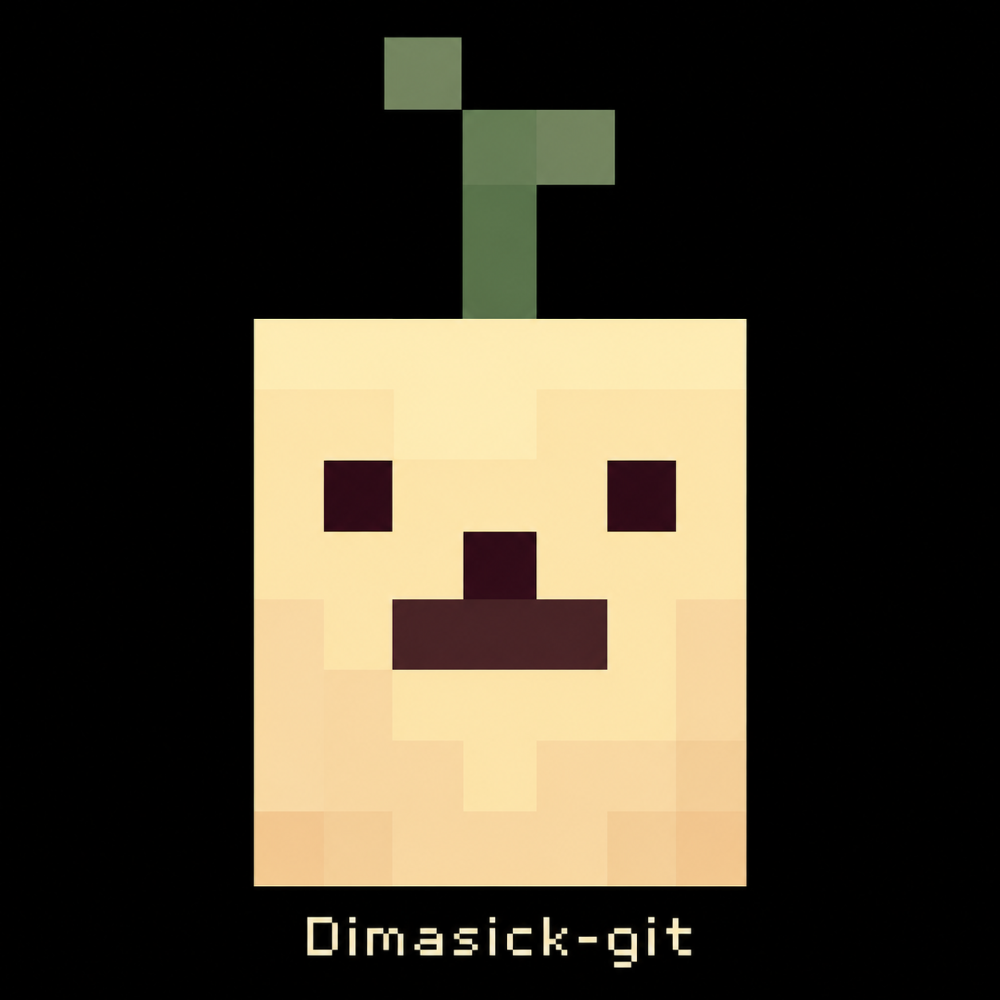

  

<h1 align="center">Lucid Blocks — NX</h1>

Неофициальный порт Lucid Blocks для Nintendo Switch. Адаптация — <a href="https://github.com/Dimasick-git">Dimasick-git</a>.

  <a href="https://github.com/Dimasick-git/LUCID-BLOCKS-NX/releases">Опубликованные сборки</a> ·
  <a href="docs/INSTALL_RU.md">Установка</a> ·
  <a href="CHANGELOG.md">Изменения</a> ·
  <a href="https://github.com/Dimasick-git/LUCID-BLOCKS-NX/issues">Сообщить о баге</a>

## NSP06 — LAN до четырёх игроков

Цельный установщик для DBI: движок, игровые ресурсы и готовый кеш мешей внутри одного NSP. Игровой пакет сжат без потерь с **1,50 ГБ до 815 МБ**. Данные читаются блоками прямо из установленной игры; распаковка полного пакета на microSD при запуске не нужна.

- Облегчённая вода: анимация и цвет сохранены, чтение экрана и глубины для преломления убрано.
- Матовое освещение блоков и отключённые локальные тени.
- Рендер 75%, дальность 32 блока, минимальные эффекты и общая громкость 75/75 по умолчанию.
- Кеш подготовки чанков, ограниченная очередь мешей и штатный CPU FastLoad только на загрузке. Рабочие потоки используют разрешённую маску ядер процесса.
- LAN для 2–4 игроков: создание комнаты из меню, автоматический поиск и подключение без IP, общий мир и спавн рядом; личные сохранения гостя отделены от сетевого кеша.
- 321 готовый меш предметов; варианты с общей иконкой переиспользуют геометрию.
- Поддержка SaltyNX: FPS после показа кадра и лимит FPSLocker через движок.

**Тестовая сборка.** На ПК проверены хост и три клиента: автоматический поиск, общий спавн, блоки в обе стороны, предметы и действия, выход в меню. Отдельно проверены 848 предметов. В NSP06 исправлен обнаруженный в отчётах NSP05 доступ к выгруженному чанку, уменьшены лишние обновления существ и сетевые очереди, переделана передача снимка мира. Эти изменения ещё требуют прогона на Switch; стабильные 60 FPS не подтверждены.

## Установка

Установи `LUCID_BLOCKS_NX_FULL_NSP06.nsp` через DBI на всех консолях и запускай с HOME. Этот NSP содержит игру; прежний маленький форвардер запускал файлы с карты.

Для LAN подключите 2–4 Switch к одному роутеру. Хост: **LAN Co-op → Создать комнату → выбрать мир**. Остальные: **LAN Co-op → Найти игру**. IP вводить не нужно, хост сразу продолжает игру. Всем нужен NSP06: старые сборки используют другой протокол. Интернет-комнат в этой сборке нет.

Сохранения остаются в `/switch/lucid-blocks/LucidBlocksNX/`, журнал — в `/switch/lucid-blocks/boot.log`. При обновлении эту папку сохраняй. [Подробная инструкция](docs/INSTALL_RU.md).

## Разработка

Основа: Godot/Horizon, GLES Compatibility и статический gdblocks с double precision. В репозитории находятся патчи, загрузчик, инструменты сборки и документация. Игровой пакет, установщики, ключи и личные сохранения в Git не включаются.

[Сборка и проверки](docs/DEVELOPMENT_RU.md) · [Формат сжатия](docs/PACK_FORMAT.md) · [Авторы и сторонний код](Credits.md)

Оригинальная игра: [Lucid Blocks в Steam](https://store.steampowered.com/app/3495730/). Порт не является официальным выпуском авторов игры.
